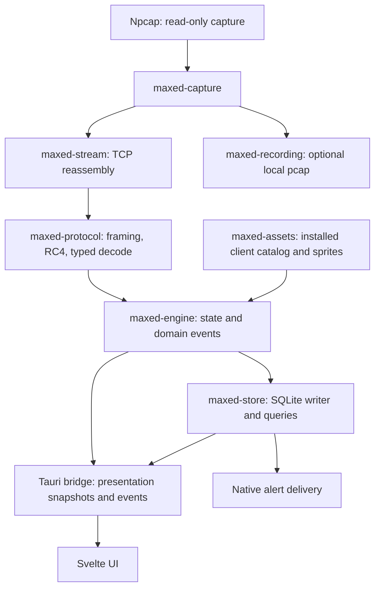

# Architecture

Maxed separates passive observation, deterministic interpretation and local presentation. The desktop application is Windows-only; core crates also support synthetic tests and offline replay.

`maxed-types` owns shared DTOs and generated TypeScript bindings. `maxed-cli` supplies offline decode, scrub, export, parity and synthetic-fixture tools. The Tauri shell joins workers, manages settings and assets, and exposes guarded commands; the UI does not open packet streams or databases.

- [Runtime](runtime.md): sequencing, byte channels, deltas and shutdown.
- [Storage](storage.md): durability, schema and query semantics.
- [Recording](recording.md): opt-in capture files, ownership and quota.
- [Assets](assets.md): bounded local extraction and cache generation.
- [UI](ui.md): subscription, current observation and saved-history ownership.
- [Alerts](alerts.md) and [personal bests](personal-bests.md): durable eligibility and delivery.

Read [privacy](../../PRIVACY.md) before changing diagnostic or network behavior. [Parity](../parity/README.md) describes the reference comparison and its limits.

Npcap requires a separate installation because its free license forbids bundled
redistribution without separate redistribution rights. Maxed does not bundle it.
The product name is Maxed; do not use Realm, RotMG or Oryx as product names.
Realm of the Mad God is used descriptively and retains its owner's trademarks.
